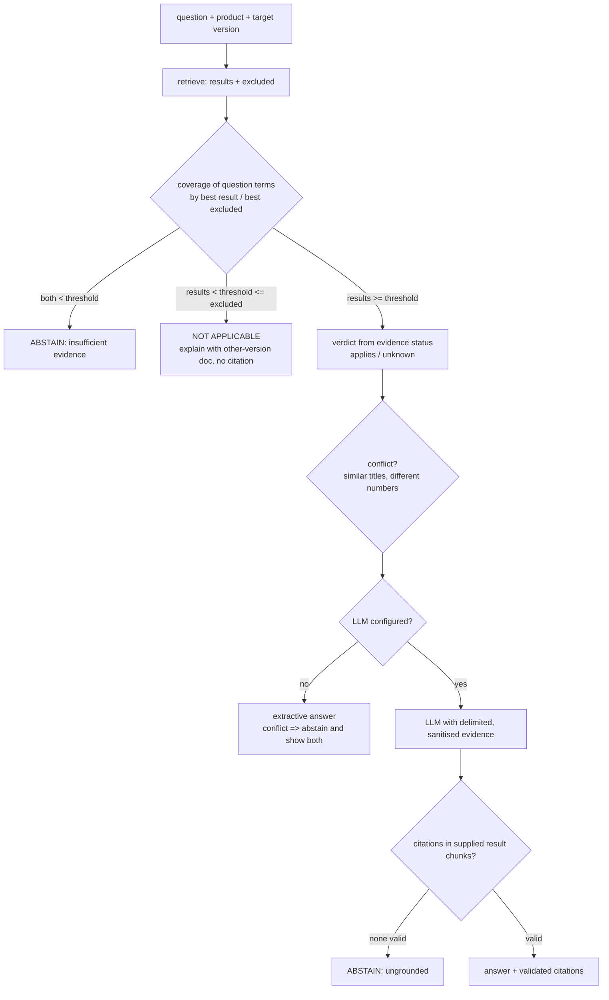

# Evidence-based answer engine

`app/generation/engine.py`. The LLM is optional; every decision that affects correctness is
deterministic and happens before (or after) the model is called.

## Response model
`answer, target_product, target_version, applicability_status, abstained, generation_mode
(extractive | llm | none), model_identifier, evidence[], excluded[], citations[], warnings[],
unresolved_questions[], conflicts[], diagnostics{}`.

## Evidence sufficiency (abstention)
Question terms = stemmed content lexemes (weight 1) + technical identifiers (weight 3). Release
labels are stripped first: the target version is a constraint, not topical evidence. Coverage =
weighted share of terms found anywhere in a result's **document revision** (answers often span
chunks). `MIN_EVIDENCE_COVERAGE` (default 0.5) is the threshold. This is a lexical heuristic: it
can abstain on heavily paraphrased questions and can be fooled by keyword stuffing. It was tuned
on the 10-question synthetic dev set and has **not** been validated on held-out data.

## Verdict
Derived from evidence, never from the model: `applies` if a sufficiently covering result is
verified for the target; `unknown` if only unverified sources cover it; `not_applicable` if the
only covering documentation is verified for other releases. Applicable evidence always wins over
a better-matching excluded source.

## Conflicts
Two different documents with similar titles (Jaccard >= 0.6) stating different numbers are
reported as a conflict. The engine shows both and prefers neither; in extractive mode a conflict
is an abstention. It detects numeric disagreement only.

## Citations
The model may cite only chunk ids of supplied *result* evidence. Ids are validated server-side:
unknown ids and excluded-chunk ids are dropped and reported; an answer left with no valid
citation is discarded as ungrounded. Nothing the model writes can create a citation.

## Prompt-injection boundary
The system prompt is a constant. Retrieved text goes in the user turn inside `<evidence>` /
`<excluded>` blocks declared as untrusted data; block-like tags inside retrieved text are
neutralised so a document cannot close its own block. The engine never executes anything from
retrieved text, and the verdict/abstention logic does not depend on model output. This reduces,
not eliminates, injection risk: a poisoned document can still bias the wording of an LLM answer.

## Providers
`LLM_PROVIDER=none` (extractive) or `anthropic` (`LLM_API_KEY`, `LLM_MODEL`). The Anthropic
client was not exercised in development (no credentials); LLM behaviour is tested with a
scripted fake provider.
