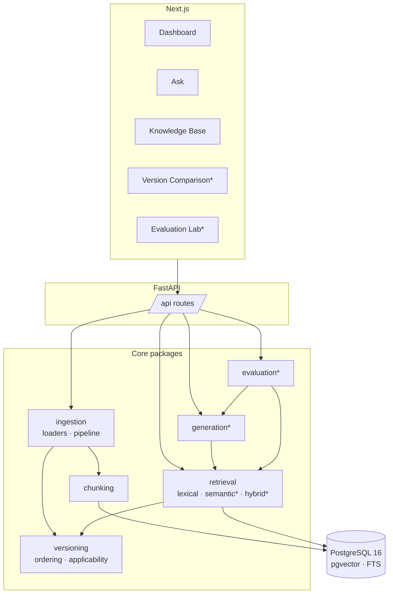

# Architecture

VersionProof AI is a single FastAPI service, a PostgreSQL database with pgvector, and a Next.js UI.
No microservices: the components below are Python packages with explicit interfaces so each can
be replaced or tested independently.

`*` = later phase.

## Components and interfaces

| Component | Interface | Phase 1 implementation |
|---|---|---|
| Documentation source | `ingestion.interfaces.DocumentLoader` | JSON fixture, Markdown (front matter), plain text |
| Ingestion | `ingestion.pipeline.IngestionPipeline` | revision dedup by SHA-256, provenance-preserving |
| Chunking | `chunking.interfaces.Chunker` | `HeadingChunker` (deterministic, size-capped) |
| Version ordering | `versioning.ordering.VersionOrdering` | `semver`, `salesforce_seasonal`, `explicit` |
| Applicability | `versioning.applicability.resolve` | verified / inferred / unknown |
| Retrieval | `retrieval.interfaces.Retriever` | `LexicalRetriever`, `SemanticRetriever`, `HybridRetriever` (RRF) + exclusion list |
| Embeddings | `embeddings.interfaces.EmbeddingProvider` | `hashed` (offline), `sentence_transformers` |
| Evaluation | `evaluation.metrics` + `retrieval_runner` | retrieval-only runs stored as `EvaluationRun` |
| Generation | *(Phase 3)* provider protocol | `LLM_PROVIDER=none` |

## Request flow: `/api/search`
1. Resolve product and target release → integer `sequence` via the product's ordering.
2. Extract technical tokens from the query; build strict and relaxed tsqueries.
3. SQL query over `document_chunks` joined to current revisions and release bounds, with the
   applicability constraint in the `WHERE` clause.
4. Per result, compute `ApplicabilityStatus` and attach evidence fields and diagnostics.

## Key trade-offs
- **PostgreSQL for both lexical and vector search** keeps one store, one transaction model and
  one backup story. We accept weaker BM25 fidelity than a dedicated engine; the evaluation lab
  will quantify it.
- **Synchronous ingestion** in Phase 1 (fixtures are small). A job queue is deferred until
  real documentation volumes justify it.
- **Chunk-level retrieval, revision-level applicability.** Applicability is a property of the
  revision; chunks inherit it. This avoids contradictory ranges inside one document.
- **No orchestration framework.** Retrieval and (later) prompting are ~300 lines of explicit code,
  which is easier to evaluate and secure than an abstraction layer.
