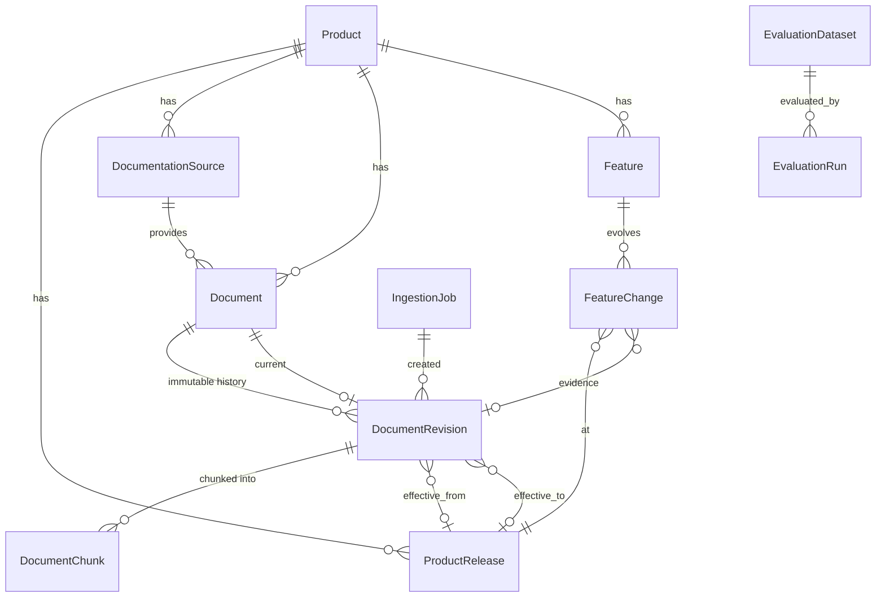

# Data model

## Principles
- **Identity vs. content.** `Document` is a stable identity (`product + external_id`).
  Content, dates and applicability live on `DocumentRevision`, which is never updated in place.
  Re-ingesting unchanged content (same SHA-256) creates nothing; changed content creates
  revision *n+1* and moves `current_revision_id`.
- **Provenance everywhere.** `DocumentRevision.applicability_provenance` and
  `ProductRelease.release_date_provenance` are enums; `metadata_provenance` is a per-field map
  (`{"published_at": "verified", "last_updated_at": "inferred"}`). The ingestion loaders reject
  any value outside `verified | inferred | unknown`.
- **Ordering as data.** `ProductRelease.sequence` is an integer computed by the product's
  `VersionOrdering`. Queries compare integers, never labels.
- **Open bounds are not "forever".** `effective_to = NULL` with provenance `verified` means
  "no end documented"; with provenance `unknown` it means "we don't know". `resolve()` treats
  these differently.
- **Publication date ≠ effective date.** They are separate columns and neither is ever used to
  infer the other.

## Entities (Phase 1 use)
| Entity | Used now | Notes |
|---|---|---|
| Product, ProductRelease | yes | `version_scheme` chooses the ordering strategy |
| DocumentationSource | yes | `trust_level`: official / community / synthetic / untrusted |
| Document, DocumentRevision, DocumentChunk | yes | `search_vector` (tsvector), `embedding` (vector(384), NULL until Phase 2) |
| IngestionJob | yes | stats + per-document failures; never reports success it didn't achieve |
| Feature, FeatureChange | schema only | Phase 4 version intelligence |
| EvaluationDataset, EvaluationRun | dataset registered | Phase 5 runs |
